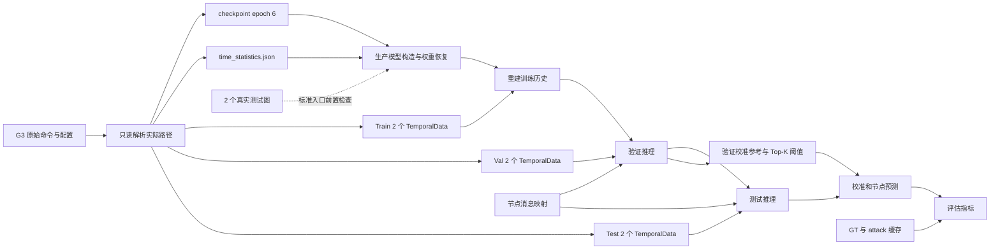

# THEIA_E5 最小迁移与 Windows 真实 GPU 实测

**最终验收：迁移、真实 GPU 两窗口推理和评估 PASS；跨平台严格数值等价 FAIL。**
对照程序成功执行并保留全部差异，机器报告标记为 `NOT_ESTABLISHED`。
原始损失接近，但经验校准、节点分数和部分排序指标存在差异，不能将推理可运行性解释为数值等价。

日期：2026-10-19。原始证据保存在
`artifacts/windows-e5-migration/20261019/`；真实数据和实验日志在
`F:\Paper\Data\MSTC-Data`，不进入 Git。

## 版本与 G3 证据

服务器当前 HEAD 是 `027962c372df3ad2d3e5ffd0a09351e06c75e409`，
Windows 开始任务时 HEAD 是 `63861d809ab5133edcb253a1a99b0afa8bd8df10`。
G3 原始报告记载运行时 Git HEAD 为 `ec53563c526af22fac280854f581e792fc2ad1e8`；
不能把它改写成后来提交的 HEAD。报告 `source_sha256.json` 的 **67 个实际运行源码哈希**
与当前服务器源码全部一致，因此使用源码指纹建立对应关系。

只读核验了 `preflight.json`、`commands.json`、`execution.json`、
`checkpoint_identity_before.json`、`source_sha256.json`、两个策略 YAML、
`g3_equivalence_report.json`、运行配置和 backend 记录。
G3 的 `G3_POLICY_EQUIVALENCE_GATE=PASS`、`execution.json` 中 `gate_returncode=0`、共同最佳 epoch=6 已核实；
本任务没有重新执行 G3。服务器原有三个未跟踪报告/任务文件未处理。

服务器环境为 Python 3.10.19、PyTorch 2.4.1+cu124、PyG 2.8.0.post1、RTX 4090；
Windows 为 Python 3.10.11、PyTorch 2.9.0+cu128、PyG 2.8.0.post1、RTX 5070 Laptop。
两平台的软件和硬件不同，数值逐位一致必须靠输出对照验证。

## 实际依赖链

G3 保存的 `config_resolved.yml` 过滤了下划线派生字段。审计程序读取其
`commands.json` 原始参数，通过冻结 `get_yml_cfg` 和 `resolve_artifact_paths(create_dirs=False)`
只读恢复实际路径；未凭文件名推测根目录。



训练窗口用于 replay，验证窗口用于校准和阈值，测试窗口不参与拟合。
TimeGap 和多尺度边界直接读取已有 `time_statistics.json`，不重新拟合。
特征已保存在 TemporalData，推理不需要词向量训练、原始数据库或原始事件集。
紧凑索引可以从六个窗口重建，因此不复制服务器 sidecar 或历史状态。
`testing.include_node_messages=true` 保持 G3 原值，所以复制 `nodeid2msg.pkl`；
省略更大的 `node_metadata.pkl` 及其他不被这条 MSTC 路径消费的缓存。

实际窗口与模型输入事件数如下。日期/时刻采用原文件的 US/Eastern 表示。

| Split | 窗口 1 | 窗口 2 | 事件数 |
| --- | --- | --- | ---: |
| Train | 05-08 00:00:01–00:15:29 | 05-08 00:15:29–00:33:01 | 31785 + 131023 = 162808 |
| Val | 05-11 00:00:00–00:15:10 | 05-11 00:15:10–00:32:00 | 32672 + 35340 = 68012 |
| Test | 05-14 00:00:00–00:15:53 | 05-14 00:15:53–00:30:54 | 146467 + 38903 = 185370 |

原始窗口路径、文件名、SHA256、类型、用途、依赖、符号链接状态和 Windows 目标路径
全部见本地数据包旁的 `manifest.json`，以及仓库日志目录的 `manifest.server.json`。
Windows 文件名将 `:` 转义为 `%3A`，原始文件字节不变。

## 迁移量与完整性

| 类别 | 文件数 | Bytes |
| --- | ---: | ---: |
| 六个 TemporalData 窗口 | 6 | 462822048 |
| 最佳 checkpoint | 1 | 10002484 |
| 时间统计 | 1 | 439 |
| 三个必要 metadata | 3 | 143014938 |
| 标准入口要求的两个真实测试图 | 2 | 38916256 |
| 已有 Linux 对照输出 | 11 | 151927338 |
| 合计 | 24 | 806683503 |

原始总量 **0.7512825569 GiB**；压缩包 **191815228 Bytes**，低于 5 GiB 限制。
只迁移一个 checkpoint，未复制其余五个，也未复制原始数据库、全量窗口或历史日志。

最佳 checkpoint SHA256：
`1e17dd106d51cb5ea2869034e7bd8b003262bc7f03992d3e4d82659acfc994a8`。
它与 G3 `checkpoint_identity_before.json` 记录完全相同。

压缩包位置：
`/home/yby/mstc/exports/windows_e5_smoke/package_20261019_v1/inputs.tar.gz`。
SHA256：`b999757e589acf7aee70c4cfaff91e9562a5d34c5771da0e2e4195ab4ad57871`。

Windows 包目录：
`F:\Paper\Data\MSTC-Data\artifacts\windows_e5_smoke_transfer\20261019`。
部署根目录：`F:\Paper\Data\MSTC-Data`。包哈希与 24 个 payload 哈希均已核验。
该目录包含 manifest、校验和、Python 解包程序及 `verify_windows.ps1`。

服务器共享根下的图/metadata 父目录原本是符号链接，目标在
`/home/yby/mstc/orthrus-formal-host/artifacts/...`。审计先核实这些实际输入根，
再在清单中保留别名和规范路径；打包只读取允许根内的普通文件，不打包链接对象。
部署拒绝路径穿越、特殊文件、大小写冲突、Windows 非法名称、符号链接和 junction。
已有同哈希文件可复用；任何冲突文件均保留并报错。

## 运行方式与边界

新增脚本均为外围审计/传输/运行/对照工具；本轮没有修改 `src` 中的模型或算法代码。
新增工具的独立测试 **37 passed**，未重复上一轮 878 项基础回归。

真实预检通过：配置解析、六个真实窗口及字段契约、CPU 模型构造与权重恢复、
128 事件真实 GPU 前向，输出全部有限。预检耗时约 12.82 秒，
峰值 GPU 分配 **111964672 Bytes**，峰值进程工作集 **5507.3203125 MiB**。

完整模式调用生产 `orthrus.main(cfg, stages=test,evaluate)`，原有 reset → train replay →
val → test 和评估过程均保留。只指定已有 `model_epoch_6`，不训练、不重新搜索六个 epoch。
128 仅用于独立资源探针，正式 Val/Test 批大小保持 **512**，与 G3 一致。
邻居预算 `[8,8,8]`、candidate capacity=64、history_device=cpu、TimeGap、校准、
Top-K=5、quantile=0.999 和模型结构均保持；使用原有确定性推理上下文。
CUDA 初始化前使用与 G3 相同的 `CUBLAS_WORKSPACE_CONFIG=:4096:8`，并记录 backend。

```powershell
& 'F:\venvs\mstc-pids\Scripts\python.exe' scripts/run_e5_gpu_smoke.py --manifest 'F:\Paper\Data\MSTC-Data\artifacts\windows_e5_smoke_transfer\20261019\manifest.json' --data-root 'F:\Paper\Data\MSTC-Data' --run-root 'F:\Paper\Data\MSTC-Data\logs\e5_real_two_window_20261019' --probe-batch-size 128 --full
```

原有实验目录不可覆盖，复跑必须换新的 `--run-root`。每次保存解析配置、路径映射、
Git/version、输入和 checkpoint SHA、资源峰值、时间、阶段状态与退出码。
正式结果见 `F:\Paper\Data\MSTC-Data\logs\e5_real_two_window_20261019`。

对照脚本流式读取保存的 CSV，分别报告离散身份/预测、IEEE-754 binary64 解析值逐位一致、
数值接近和实际差异。诊断容差固定为 atol=1e-6、rtol=1e-5，不把 close 当作严格等价。
匹配的未定义 NaN 指标会单独标记；非有限事件评分直接报错。

## 最终实测与验收

真实运行目录：`F:\Paper\Data\MSTC-Data\logs\e5_real_two_window_20261019`。
完整控制台日志为其同名 `.log` 文件；目录内 `smoke_result.json` 包含逐阶段结果、
输入/权重/脚本哈希、运行时 HEAD、软件版本、backend、配置和资源记录。
`config_resolved.windows.yml` 为实际配置，`metadata` 保留运行元数据。

| 阶段 | 状态 | 证据 |
| --- | --- | --- |
| A：G3 真实依赖追溯 | PASS | server-audit.json、恢复的实际运行配置和清单 |
| B：最小输入清单 | PASS | 24 个文件，806683503 Bytes |
| C：打包与传输 | PASS | 包 SHA256 与所有成员 SHA256 均通过 |
| D：本机部署与真实加载 | PASS | 六窗字段/类型/时间序列契约、CPU 权重恢复均通过 |
| E：GPU 小批探针及完整两窗流程 | PASS | 两次实验子进程退出码均为 0，无 OOM；未训练 |
| F：读取 G3 已有输出并完成比较 | PASS | comparison-command.json 退出码 0 |
| F：严格数值等价验收 | FAIL | 原始分数不逐位一致，校准及节点分数超出诊断容差 |
| 服务器后验保护检查 | PASS | 8 个 G3 证据、24 个输入/参考文件与 67 个源码哈希均未变 |
| 部署幂等复核 | PASS | copied=0，reused=24，未重复传输 |
| 本轮全量训练 / 六候选选择 / Linux G3 重跑 | NOT_RUN | 不属于本轮执行范围；Windows 使用 Linux 预选 epoch 6 |

完整运行保留原始 batch size=512、seed=0 和原始数值配置。训练事件仅用于历史回放，
`time_gnn_training=0`。Train/Val/Test 事件数分别为 **162808 / 68012 / 185370**。

| 资源或耗时 | 实测值 |
| --- | ---: |
| 正式运行前可用显存 | 7338983424 Bytes（约 6.84 GiB） |
| PyTorch 峰值 allocated | 651260928 Bytes（621.09 MiB） |
| PyTorch 峰值 reserved | 931135488 Bytes（888 MiB） |
| 实验进程峰值 RAM 工作集 | 7651.703125 MiB（约 7.47 GiB） |
| 两窗生产流程 | 476.85 秒（内部计时 476.73 秒） |
| 其中历史回放及推理 | 424.93 秒 |
| 其中评估 | 51.81 秒 |
| 实验脚本总耗时（含预检） | 488.93 秒 |
| 外层进程墙钟耗时 | 496.29 秒 |

allocated/reserved 是 PyTorch 分配器统计，不包含完整 CUDA 上下文、驱动与其他进程。
运行期间 `nvidia-smi` 曾观测整卡占用约 3.25 GiB，属于采样值，不能称为整卡峰值。
这里的 RAM 是实验进程峰值工作集，不能称为整个系统内存峰值。
Linux G3 包含六个候选 checkpoint 的工作量，因此不可直接以其总耗时计算本次跨平台加速比。

对照产物：`artifacts/windows-e5-migration/20261019/windows-linux-comparison.json`。
比较解析 CSV 后的 IEEE-754 binary64 数值，身份、顺序与其余离散/文本字段逐项精确核对。

| 对照项 | 结果 |
| --- | --- |
| Val/Test 事件数和身份顺序 | 分别 68012 / 185370，完全一致 |
| 节点记录数和节点顺序 | 119357，完全一致 |
| 所有离散字段，包括时间预测类别、校准层级、节点标签 | 完全一致 |
| Val 原始异常分数 | 47674 项不逐位一致；最大绝对差 3.09944e-6，全部在固定诊断容差内 |
| Test 原始异常分数 | 126236 项不逐位一致；最大绝对差 2.86102e-6，全部在固定诊断容差内 |
| 事件类型损失 | Val/Test 最大绝对差 3.21865e-6 / 2.86102e-6，全部在诊断容差内 |
| 综合时间损失 | Val/Test 最大绝对差均为 9.53674e-7，全部在诊断容差内 |
| Val 校准分数 | 27890 项超出容差，最大绝对差 2.25878247 |
| Test 校准分数 | 19617 项超出容差，最大绝对差 1.53393036 |
| 节点分数 | 3124 项不逐位一致，其中 2755 项超出容差，最大绝对差 0.88460894 |
| 验证阈值 | 完全一致：7.916655577588685 |
| 节点预测与混淆矩阵 | 完全一致：TP=0、FP=1、FN=1、TN=119355 |
| AUROC | Linux 0.9991873052045981；Windows 0.9992878447669158，存在差异 |
| AUPRC | Linux 0.01020408163265306；Windows 0.011627906976744186，存在差异 |
| 验证目标值 | Linux 1.5045075498116878；Windows 1.5045075474603486，绝对差约 2.35e-9 |
| 最佳 checkpoint | 输入为 Linux 预选的 epoch 6；未独立验证 Windows 六候选最优性 |

F1/fscore 在两边均为未定义 NaN，报告单独标记，不能解释为有效性能通过。
阈值与二元预测相同也不能抵消分数和排序指标的差异。

校准差异已有局部可核验解释：生产代码通过 `np.searchsorted(..., side="left")`
计算参考分数大于等于当前分数的数量，再转换为经验 p 值和 `-log(p)`。
保存分数重算报告 `calibration-diagnostic.json` 复现了最大 p 值差异样例：
测试事件 369549 的原始分数从 8.029250144958496 变为 8.029248237609863，
369 个 triplet 参考分数中计数从 43 变为 203，p 值从 0.11891891891891893
变为 0.5513513513513514。174 个参考值在该分数 4e-6 范围内，
说明微小浮点偏移可以通过近似并列的经验排序放大；这不是“所有输出仅有可忽略尾差”。
该诊断没有隔离最初浮点偏移究竟来自 GPU、CUDA、PyTorch 或内核实现中的哪一项，
不能把原因唯一归给 Windows。没有通过舍入、放宽容差或修改校准公式消除差异。

主要命令与退出码保存在 `preflight-command.json`、`full-command.json`、
`comparison-command.json`、`server-postcheck-command.json`、`redeploy-command.json` 和 `commands.json`。
预检、真实运行、比较、后验检查和幂等部署的子进程退出码均为 0。
原外层日志展示器在真实子进程结束后按 UTF-8 读取本机混合编码日志失败，退出码为 1；
`full-command.json` 已在展示失败前写入真实子进程退出码 0，
且 `smoke_result.json` 与完整原始字节日志均完整保留。没有因此重跑实验或伪造退出码。
初次清单因父目录符号链接被安全检查拒绝，核实实际目标后通过；历史 BLOCKED 记录保留。

代码变更仅新增三个外围脚本、对应测试和本文档：传输工具负责清单/打包/安全部署，
运行工具负责本机路径映射/预检/资源记录，对照工具负责如实报告数值差异。
`src` 和既有 tracked 文件保持原状，新增文件尚未提交；任务期间 HEAD 仍为 `63861d8`。
运行记录另存脚本 SHA256，避免以旧 HEAD 冒充包含本轮新增脚本的提交。

当前无需继续搬运数据或训练即可复用本次结果。若后续目标升级为跨平台严格数值等价，
最小下一步是在现有保存分数上量化近似并列排序敏感性，并在独立批准的实验中隔离软件/硬件变量；
任何校准公式或并列规则改动都应另开算法变更，重新验收，不能作为本轮 I/O 修补。

## 限制和成本

G3 的原始 protected snapshot 没有逐项列出这六个窗口的 SHA。已证明的是当前 G3 配置
引用文件与迁移到 Windows 的字节相同，并核对历史 checkpoint、源码指纹及保存输出；
不能声称重新获得了当时未保存的窗口哈希快照。CSV 解析值一致也不代表所有 GPU 中间张量逐位一致。

窗口少、checkpoint 小并不意味着运行内存小：实际最大节点 ID 范围约 228.6 万，
HistoryStore 仍按该范围分配状态。实测峰值 RAM 应作为部署要求，不能按 183 MiB 包大小估算。
测试窗口为 05-14 凌晨，而配置声明的攻击时段为 05-15 14:47–15:08；
本任务只能证明这个 G3 前缀子集的推理可运行性和输出复现情况，不能据此评价完整攻击检测性能。

认证使用本机专用 key `C:\Users\HONOR\.ssh\id_ed25519_mstc_e5_smoke`；私钥仅留本机，
ACL 限制到当前用户。公钥由用户在服务器追加并带 `restrict` 限制。本机 ssh-agent 服务配置
因权限被拒绝，实际连接使用显式 `ssh -i`，未修改现有 SSH 配置或上传私钥。
